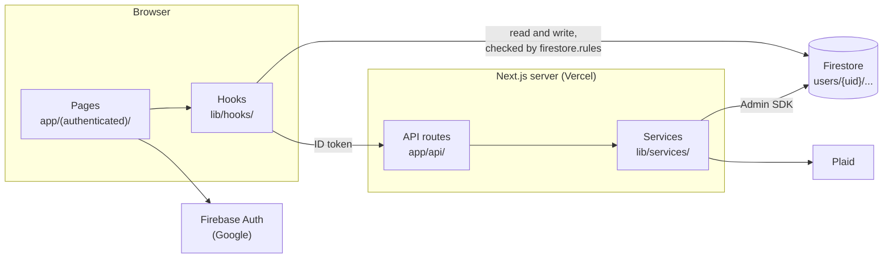

# Architecture

How Telos is put together. Start with the picture, then the folder map.

## The big picture



There are two paths to the database:

1. **Browser to Firestore, directly.** Pages use hooks that read and write Firestore with the Firebase web SDK. Most reads are live listeners, so changes made anywhere (another tab, a sync on the server) show up without a refresh. `firestore.rules` limits what the browser may do.
2. **Browser to API route to Firestore.** Anything that needs a secret or can't be trusted to the browser goes through an API route: every Plaid call, token encryption, sync, disconnecting a bank, and permanently deleting an account. Routes use the Firebase Admin SDK, which bypasses the rules.

### Who owns what

| Data | Written by | Why |
|---|---|---|
| Plaid connections and access tokens | Server only | Secrets. The browser can't even read them. |
| Transactions | Server, except the category fields | They come from Plaid. You only choose the category. |
| Linked accounts' balances and Plaid fields | Server only | They come from Plaid. |
| Manual accounts, categories, budgets, automations, and settings | Browser | Your own data, protected by owner checks in the rules. |

Full details are in [Data model](data-model.md) and [Security](security.md).

## Folder map

```
app/
  (authenticated)/       Signed-in pages. layout.tsx holds the nav and the sign-in guard.
    dashboard/  accounts/  categories/  budgets/  transactions/  automations/  settings/
    oauth/               Where banks that use OAuth send you back; resumes Plaid Link
  api/                   Server routes (see api-reference.md)
    plaid/               create-link-token, create-update-link-token, exchange-token, sync,
                         refresh, rebuild, usage, disconnect-item
    accounts/delete/     Permanent account delete
  login/                 Google sign-in page
  layout.tsx, providers.tsx, page.tsx (redirects to /dashboard), not-found.tsx

components/              Shared UI: page header, month picker, logo, archive warning dialog,
                         TransactionsProvider (one transactions listener per visit)

lib/
  hooks/                 Browser data access, one hook per area
                         useAuth, useAccounts, useCategories, useBudget, useTransactions,
                         useAutomations, useSettings, usePlaidAccountLink, useAutoSync
  services/              Server logic
                         plaidService, syncService, syncPlanner, syncLoop, linkGate,
                         accountReconcile, plaidEnv, plaidUsage, ruleEngine,
                         encryption, auth, rateLimit, logging
  api/handler.ts         withUser wrapper used by every route
  budgetCalculations.ts  Shared budget, cash-flow, and net-worth math
  paycheck/paycheck.ts   Net pay and deduction math
  merchant.ts            normalizeMerchant, shared by browser and server
  connections.ts         Bank status, sync age, and when to sync automatically
  plaidSync.ts           runSync, refreshFromBank, rebuildFromPlaid (browser)
  plaidLinkState.ts      Saves a Link session for the OAuth return
  exportCsv.ts           The Settings CSV export
  types/types.ts         Shared types
  firebaseClient.ts      Browser Firebase SDK
  firebaseAdmin.ts       Admin SDK, created on first use
  authenticatedFetch.ts  fetch() that adds the user's ID token

tests/                   unit/ (Vitest) and rules/ (Firestore emulator)
firestore.rules          Database access rules, deployed from the repo
firestore.indexes.json   Composite indexes
firebase.json            Firebase CLI and emulator config
.github/workflows/ci.yml CI pipeline
```

## Design choices

**Pure logic is kept apart from I/O.** The parts most likely to have bugs are plain functions with no database or network calls, so they can be unit tested:

| File | What it decides |
|---|---|
| `lib/services/syncPlanner.ts` | Which transaction docs to create, update, or delete for a batch of Plaid changes |
| `lib/services/syncLoop.ts` | Paging through Plaid's changes, saving the cursor, stopping on time, and restarting after a mid-loop change |
| `lib/services/linkGate.ts` | Whether a new link is a duplicate, before anything is exchanged |
| `lib/services/accountReconcile.ts` | Which account docs to create, reattach, close, or reopen |
| `lib/connections.ts` | A bank's status, and when the browser should sync on its own |
| `lib/exportCsv.ts` | The CSV export, including the guard against spreadsheet formulas |
| `lib/services/ruleEngine.ts` (`applyRules`, `resolveWinner`, `readVotes`) | Which category a new transaction gets |
| `lib/budgetCalculations.ts` | Budget actuals, cash flow, and net worth |
| `lib/paycheck/paycheck.ts` | Net pay and deduction amounts |
| `lib/merchant.ts` | The merchant key used by automations |

**Server modules can't leak into the browser.** Every file in `lib/services/` except the pure ones (`syncPlanner.ts`, `syncLoop.ts`, `linkGate.ts`, `accountReconcile.ts`, and `plaidEnv.ts`), plus `lib/api/handler.ts` and `lib/firebaseAdmin.ts`, starts with `import "server-only"`, so the build fails if a page imports one.

**Server clients are created on first use.** The Admin SDK and the Plaid client read their environment variables when first called, not at import. `next build` and the tests run without any secrets.

**Every API route has the same shape.** `withUser` (`lib/api/handler.ts`) checks the sign-in token, applies the rate limit, and turns errors into `{ error, message }`. A route body only does its own job.

**Live listeners over manual refetching.** Hooks subscribe to Firestore. After a sync or a link, the server writes and the page updates by itself. Transactions have one listener for the whole visit, in `TransactionsProvider` in the signed-in layout, so moving between pages doesn't read them all again.

**Category choices are never overwritten.** Sync only fills in categories that are empty. See [Plaid and sync](plaid-and-sync.md).

## Request walkthrough: pressing Sync

1. The Transactions page calls `runSync()` (`lib/plaidSync.ts`), which posts to `/api/plaid/sync` with the user's Firebase ID token.
2. `withUser` verifies the token (401 if bad), checks the rate limit (429 if over), and calls the route.
3. The route calls `syncAllPlaidItems(uid, { deadline })`, which syncs each bank in turn and stops taking new pages after 40 seconds (see [Plaid and sync](plaid-and-sync.md)).
4. The server writes transactions, balances, and each bank's status doc.
5. The page's live listeners pick up the new data. The route's response reports problems, such as a bank that needs reconnecting, and whether there's more.
6. If there's more, `runSync` calls again, up to ten times.

## What's not built yet

Webhooks (syncing while Telos is closed), a privacy policy and terms, and a delete-my-account option.

Also out of scope for now: editing automations in place, showing learned defaults in the UI, vote decay, multi-currency, and error monitoring such as Sentry.
