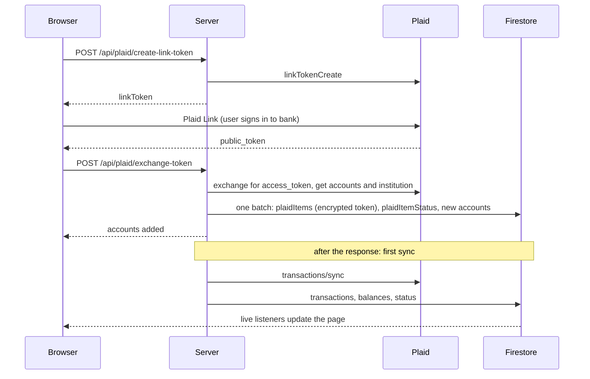

# Plaid and sync

How banks are linked, how transactions and balances stay current, and what happens when you disconnect or delete. The code is in `lib/services/syncService.ts`, `lib/services/syncPlanner.ts`, `lib/services/plaidService.ts`, and the routes under `app/api/plaid/`.

## Plaid environment

`PLAID_ENV` picks Plaid's environment: `sandbox` (the default) or `production`. Everything currently runs on sandbox. Sandbox test logins are in [Getting started](getting-started.md#6-link-a-test-bank).

## Linking a bank

Step by step:

1. **Link token.** When you click the button, the browser asks the server for a link token and opens Plaid Link with it. The token is dropped when Link closes, so each attempt uses a fresh one. If the request fails, the button shows "Try again" instead of retrying in a loop. New links ask Plaid for 730 days of history (`transactions.days_requested`), the maximum; without it Plaid sends 90 days, and the length can't be changed after linking.
2. **Exchange.** The browser sends the `public_token` to `exchange-token`. The server exchanges it for an access token and fetches the bank's accounts and name.
3. **Duplicate check.** Linking the same bank again through normal Link creates a new Plaid item with new account ids, so Telos matches on the bank plus the account's last four digits (`mask`). Accounts with no mask match on bank, name, and type. Archived accounts count too.
   - Accounts already in Telos are skipped and recorded in `skippedDuplicateAccountIds`, so their transactions are ignored.
   - If **every** account is a duplicate, the request fails with 409. If any of them is archived, the message says to restore it instead.
4. **Save.** One batch writes the connection (with the token encrypted), its status doc, and the new accounts. If saving fails, the new item is removed at Plaid so nothing is left orphaned.
5. **Respond, then sync.** The route responds as soon as the accounts are saved. The first sync runs in the background with Next.js `after()`. Plaid may need a few seconds to prepare data (`PRODUCT_NOT_READY`), so that error is retried with backoff of 1, 2, 4, and 8 seconds.

## Syncing

Sync runs when:

- You press **Sync** on the Transactions page.
- You **refresh balances** on the Accounts page.
- You **reconnect** a bank.
- You **link** a bank (first sync, in the background).

There are no scheduled syncs or webhooks yet.

`POST /api/plaid/sync` calls `syncAllPlaidItems`, which syncs each connection one after another. Each connection goes through these steps:

### 1. Take the lease

A lease stops two syncs of the same bank from running at once (say, two tabs pressing Sync). In a Firestore transaction, the server sets `syncLeaseId` and `syncLeaseUntil` (two minutes ahead) on the `plaidItems` doc. If another sync already holds an unexpired lease, this connection is skipped and reported as in progress. A lease left by a crashed run simply expires.

### 2. Fetch changes

Plaid's `transactions/sync` returns everything added, modified, and removed since the stored `cursor`, a page at a time. If Plaid reports `TRANSACTIONS_SYNC_MUTATION_DURING_PAGINATION` (data changed mid-way), the fetch restarts from the stored cursor, up to three times, as Plaid requires.

### 3. Plan the writes

`planSync` (in `syncPlanner.ts`) is a pure function. It takes Plaid's changes plus the matching docs already in Firestore and returns a list of create, update, and delete operations.

| Plaid says | Telos does |
|---|---|
| **Added**, and Telos doesn't have it | Creates it. If it's a posted transaction whose pending version had a category, it copies that category. Otherwise the rules engine picks one (see [Categorization](categorization.md)). |
| **Added**, but Telos already has it | Updates the Plaid fields only. |
| **Modified** | Updates the Plaid fields (amount, date, names, pending, Plaid category, account). Reruns the rules only if the transaction has no category. |
| **Removed** | Deletes it. When a pending transaction posts, Plaid removes the pending one and adds the posted one. |
| Any change on a skipped account | Ignored. |

**Your category is never overwritten.** An update never touches `categoryKind`, `categoryId`, or `transferAccountId` on a transaction that already has a category.

### 4. Write

The plan is committed in batches of up to 500 writes.

### 5. Refresh balances

The server calls Plaid's `accountsGet` and writes `currentBalance` and `balanceUpdatedAt` on this bank's existing accounts. It never re-creates an account you deleted.

### 6. Save the cursor and status

Only after every write succeeds does the server save the new cursor, so a failed run retries from the same place next time. If the token was stored in an old format or with an old key, it's re-encrypted here. The status doc gets `lastSyncedAt` and has its error fields cleared.

### When a sync fails

Each connection's failure is recorded on its own status doc, and the other connections keep syncing.

| Plaid error | What happens |
|---|---|
| `ITEM_LOGIN_REQUIRED` | `needsReauth` is set. The Accounts page shows **Reconnect** on that bank. |
| Anything else | `lastSyncError` holds the Plaid error code, or `SYNC_FAILED` if there isn't one. |

The sync response lists `itemsNeedingReauth`, `itemsFailed`, and `itemsInProgress`, and the Transactions page shows a short message for each.

## Reconnecting

`create-update-link-token` creates a Plaid Link token in **update mode** for an existing connection. You sign in again, the same connection and access token keep working, and the page runs a sync, which clears `needsReauth`.

## Archived accounts

A linked account that you archive **keeps syncing**. It's hidden from lists and totals, but its history has no gaps if you restore it. To stop syncing, disconnect the bank.

## Disconnecting a bank

`POST /api/plaid/disconnect-item`, through `disconnectPlaidItem`:

1. Takes the connection's sync lease, so no sync writes to its accounts meanwhile. If a sync holds it, the request fails with 409 `sync_in_progress`.
1. Revokes the item at Plaid (`itemRemove`). If Plaid already revoked it, Telos carries on.
2. In one batch: deletes the `plaidItems` and `plaidItemStatus` docs, and turns every account at that bank into a manual account (`isManual: true`, Plaid ids cleared).

History is kept and balances freeze at their last value.

## Deleting an account permanently

`POST /api/accounts/delete` works only on **archived** accounts.

1. **Check for links.** It refuses (409) if transactions transfer into the account, a transfer category points at it, or a paycheck deduction feeds it.
2. **Stop syncing.** If it's the last account at its bank, the bank is disconnected. Otherwise, holding the sync lease, the account is added to the connection's `skippedDuplicateAccountIds`, so future syncs ignore it. Either way, a running sync of that bank makes this fail with 409 `sync_in_progress`.
3. **Delete** the account's own transactions in pages of 400, then the account.

## Limits worth knowing

- Sync routes can run for up to 60 seconds (`maxDuration`).
- The browser loads the last 24 months of transactions and adds 12 months at a time on request.
- Rate limits per user per minute: sync 6, link tokens 10, exchange 5, disconnect 10, and delete 10.
