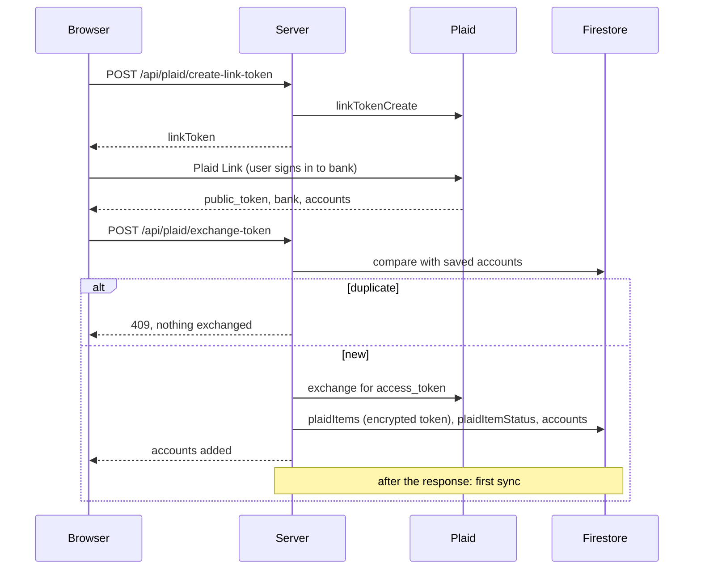

# Plaid and sync

How banks are linked, how transactions and balances stay current, and what Manage accounts, Rebuild, Disconnect, and Delete do. Server code is in `lib/services/` (`syncService.ts` does the I/O; `linkGate.ts`, `accountReconcile.ts`, `syncLoop.ts`, and `syncPlanner.ts` are pure and unit tested) and the routes under `app/api/plaid/`. Browser code is in `lib/hooks/usePlaidAccountLink.ts`, `lib/plaidSync.ts`, and `lib/hooks/useAutoSync.ts`.

## What can't be undone

| Thing | Why it matters |
|---|---|
| A connection (Plaid calls it an Item) | Every public-token exchange in Production uses one of your plan's connections (10 on the free Trial). Removing one doesn't give it back. |
| Its access token | Stored encrypted in `plaidItems`. Losing that doc or `ENCRYPTION_KEY` means linking the bank again, which uses another connection. |
| History depth | Fixed when the bank is linked. Telos asks for 730 days, Plaid's maximum. |

Everything else can be fixed without linking again: which accounts are shared (Manage accounts), an expired login (Reconnect), and every transaction (Rebuild from Plaid).

## Plaid environment

`PLAID_ENV` is `sandbox` (the default) or `production`. Each connection records the environment it was linked in (`plaidEnv`), and a server never syncs, changes, or removes a connection from the other environment: it reports them as `itemsOtherEnv`, and their cards say "Other environment". Still, give development its own Firebase project (see [Operations](operations.md#going-live-with-production-plaid)).

## Linking a bank

1. **Connect a bank.** Accounts > Add Account > Connect a Bank opens a step that lists the banks already connected, with each account's last four digits, and "Connections used: N of 10" (counted on the server across all users, in `plaidUsage/{env}`). If the bank is listed, use Manage accounts on its card instead.
2. **Link token.** Continue to Plaid requests a token and opens Link. New links ask for Transactions, plus Investments and Liabilities when the bank supports them (so brokerage, retirement, and loan accounts are shared too), 730 days of history, and the OAuth redirect (below). The token is kept in the browser for the OAuth return and dropped when Link closes.
3. **Duplicate check, before the exchange.** Link reports the bank and the accounts picked. The browser sends them with the public token, and `assessLink` compares them with your accounts. Accounts match on type plus last four digits, or type plus Plaid's own name when there's no mask, so renaming an account doesn't hide it.

   | Result | What happens |
   |---|---|
   | Every account already syncs through a connection to this bank | 409 `duplicate_item`: use Manage accounts or Reconnect on that bank. If one of them is archived, the message says to restore it. |
   | Some of them do | 409 `duplicate_accounts`. It's almost certainly the same login, and a second connection with the same login can break the first at Chase, PNC, Navy Federal, and Schwab. |
   | None do, but the bank is connected | 409 `same_institution`. The browser asks whether this is a different login (a joint or business login), and sends it again with `confirmDifferentLogin` if so. |
   | The bank isn't connected, or was disconnected | Allowed. |

   A refused public token is never exchanged, so it costs nothing.
4. **Exchange and save.** The server exchanges the token, counts the connection, and saves the encrypted access token before anything else. Saving is retried once; if it still fails, the new connection is removed at Plaid rather than left orphaned.
5. **Accounts.** Plaid's account list is checked once more against your other live connections (`findLinkedDuplicates`), and an account already synced elsewhere is skipped. If every account is, the new connection is removed and the request fails with 409. Then account docs are created, or reattached (below).
6. **Respond, then import.** The response lists the new accounts. The first sync runs in the background with `after()`, and the browser carries the import on (see [When Telos syncs](#when-telos-syncs)).

### Linking a disconnected bank again

Disconnecting keeps each account's Plaid details (bank, type, name, and last four digits). When the bank is linked again, `planAccountReconcile` matches the new accounts to those docs and reattaches them instead of creating new ones. Plaid gives the transactions new ids, so each re-imported transaction is matched to its old copy by account, date, amount, and pending state, preferring the same description. The new copy takes the old one's category, and the old copy is deleted. Old copies that never match (older than Plaid's history) stay.

### OAuth banks

Chase, Capital One, and other OAuth banks send you to their own site, then back to `PLAID_REDIRECT_URI`, which must be `https://<your domain>/oauth`. That page reopens Link with the saved link token and the return URL, then finishes the link or update. It needs:

- `PLAID_REDIRECT_URI` set in production, and the same URL under **Allowed redirect URIs** in the Plaid dashboard. It's sent on new and update-mode link tokens alike.
- The same browser that started the link, within four hours.

Without a redirect URI, Plaid leaves OAuth banks out of Link.

## Manage accounts and Reconnect

Both reopen Link for an existing connection in **update mode**. The access token stays the same, nothing is exchanged, and no connection is used.

- **Reconnect** signs in again after a password change or when consent runs out. It shows on a bank's card when the bank needs it, or when consent expires within 14 days, and as a red icon on the bank's account rows.
- **Manage accounts** turns on account selection, so you can share accounts you left out, or stop sharing some.

Afterwards the browser syncs that bank. Every sync begins by reconciling accounts with Plaid's list (`/accounts/get`):

| In Plaid's list | Telos |
|---|---|
| A new account | Creates its doc, and asks whether it's contribution eligible |
| An account already linked | Refreshes its balance and Plaid details; clears "Not shared" if it was set |
| Missing (no longer shared, or closed at the bank) | Marks it `plaidClosed` ("Not shared"). The account and its history stay. |

## When Telos syncs

| Trigger | When |
|---|---|
| Opening Telos | Any bank hasn't synced in six hours, or ever |
| A sync that stopped part way | Continues 15 seconds later |
| A bank importing history, or refreshed recently | Every two minutes |
| A bank whose last sync failed | Once its data is six hours old, then at most every 30 minutes |
| Sync (Transactions), Refresh Balances (Accounts), Refresh (a bank's card) | When pressed |
| Linking, Manage accounts, Reconnect, Rebuild | Right after |

The automatic syncs come from `useAutoSync` in the signed-in layout. They run only while the tab is visible, and skip banks that need you to sign in again. There are no webhooks yet.

## How a sync works

`POST /api/plaid/sync` (`syncAllPlaidItems`) syncs every connection, or one, least recently started first, and stops taking new pages after 40 seconds. If it stopped early it returns `more: true`, and the browser (`runSync`) calls again, up to ten rounds per run. For each connection:

1. **Lease.** A two-minute lease, taken in a Firestore transaction (`syncLeaseId`, `syncLeaseUntil`), keeps two syncs of the same bank apart. A bank already syncing is reported in `itemsInProgress`. Disconnect and Rebuild take the same lease, so they fail with 409 `sync_in_progress` rather than race a sync. The environment check happens here too.
2. **Accounts.** `/accounts/get`, reconciled as above. Balances are written, and one snapshot per account per day goes to `balanceSnapshots`, because Plaid can't provide past balances.
3. **Consent.** Once a day, `/item/get` refreshes when the bank's consent expires.
4. **Pages.** `/transactions/sync`, 500 transactions per page, with Plaid's v2 categories (pinned, so they never change meaning) and the bank's original description. Each page is planned (`planSync`), written, and only then its cursor saved, so a sync that stops resumes where it left off, and a page fetched twice does no harm (`runSyncLoop`).
5. **Data changed mid-way.** If Plaid reports `TRANSACTIONS_SYNC_MUTATION_DURING_PAGINATION`, the loop restarts from the cursor it began at (`loopStartCursor`, saved with every page), up to three times, as Plaid requires.
6. **End of the loop.** Removed transactions are deleted, a rebuild finishes, and the status doc gets `lastSyncedAt`, `importStatus`, and `hasMore`. A token stored with an old key is re-encrypted.

### What each change does

| Plaid says | Telos does |
|---|---|
| **Added**, and it's new | Creates it. A posted transaction takes the category of its pending version, and a re-imported one takes its old copy's. Otherwise the rules engine picks one (see [Categorization](categorization.md)). |
| **Added** or **modified**, and it exists | Updates the Plaid fields. Reruns the rules only if it has no category. Never touches your name, hiding, or notes. |
| **Removed** | Marks it `removedByPlaid`, which hides it at once, and deletes it when the loop ends. A posted transaction in a later page can still copy the pending one's category. |
| Anything on an account that doesn't sync | Ignored |

**Your category is never overwritten.** An update never touches `categoryKind`, `categoryId`, or `transferAccountId` on a transaction that already has a category.

Each transaction stores what Plaid sends: amount, date and authorized date, merchant name and id, description and original description, logo, website, payment channel, pending state, and the category with its confidence.

### History arrives in stages

Plaid sends roughly the last 30 days first, then the rest of the two years, usually within minutes and sometimes over a few hours. `importStatus` follows it (`not_ready`, `initial`, then `historical`), and the bank's card says "Importing history…" until it's done. Telos checks every two minutes meanwhile, so there's nothing to press.

### When a sync fails

| Plaid error | Result |
|---|---|
| `ITEM_LOGIN_REQUIRED`, `ACCESS_NOT_GRANTED`, `NO_ACCOUNTS`, or `USER_PERMISSION_REVOKED` | `needsReauth` is set, and the bank shows Reconnect |
| Anything else | `lastSyncError` holds the Plaid error code (or `SYNC_FAILED`), and the card says "Sync failed". Telos retries on its own. |

One failing bank never stops the others. Last Synced on the Transactions page shows the bank synced longest ago, with "N banks need attention" under it, so a stuck bank isn't hidden by the healthy ones.

## Refresh from bank

Plaid checks each bank for new transactions one to four times a day. **Refresh** on a bank's card calls `/transactions/refresh`, which asks Plaid to check now. New transactions arrive over the next few minutes, and Telos syncs every two minutes for ten minutes afterwards.

## Rebuild from Plaid

In a bank card's menu. Re-imports the bank's full history from an empty cursor, without linking it again. Transaction ids don't change, so categories are kept; transactions Plaid no longer has are deleted when the rebuild finishes. Accounts that are no longer shared keep their history. Use it instead of clearing data.

## Disconnecting a bank

In a bank card's menu, after typing DISCONNECT. The dialog warns that Plaid doesn't give the connection back. `POST /api/plaid/disconnect-item` (`disconnectPlaidItem`):

1. Takes the lease; 409 `sync_in_progress` if the bank is syncing.
2. Revokes the connection at Plaid (`/item/remove`). If Plaid already revoked it, Telos carries on.
3. In one batch, deletes the `plaidItems` and `plaidItemStatus` docs and turns the bank's accounts into manual accounts. History is kept, balances freeze, and the accounts keep their Plaid details so linking the bank again reattaches them.

Deleting accounts never disconnects a bank.

## Archived accounts

A linked account you archive **keeps syncing**. It's hidden from lists and totals, but its history has no gaps if you restore it. To stop syncing one account, use Manage accounts.

## Deleting an account permanently

`POST /api/accounts/delete` works only on **archived** accounts:

1. **Still shared?** If its bank still shares it, the request fails with 409 `still_shared`, because the next sync would bring it back. Stop sharing it with Manage accounts, or disconnect the bank, first.
2. **Links.** It fails with 409 `account_in_use` while transactions transfer into the account, a transfer category points at it, or a paycheck deduction feeds it.
3. **Delete.** Its transactions and balance snapshots go in pages of 400, then the account.

## Limits worth knowing

- The sync and exchange routes can run for 60 seconds (`maxDuration`). A sync stops taking new pages after 40.
- Rate limits per user per minute: sync 10, link tokens 10, exchange 5, refresh 4, rebuild 2, usage 30, disconnect 10, and delete 10.
- The browser keeps one live listener for the session, covering the last 24 months; Load older adds 12 months at a time.
