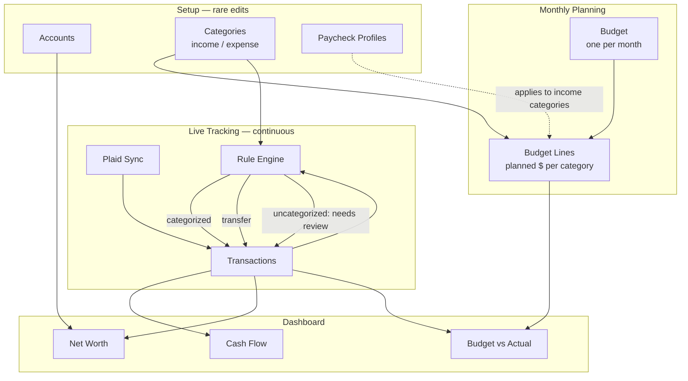

# Terminology & App Flow

A proposal for cleaning up the object model naming, based on your current design and how comparable apps (YNAB, Monarch, the old Mint) name the same concepts.

## TL;DR

| Keep as-is | Rename | Why |
|---|---|---|
| **Account** | — | Already the industry-standard term. |
| ~~Cashflow~~ | **Category** | "Cashflow" collides with the *metric* "cash flow" (money in vs. out) shown on your own dashboard. Every major competitor calls this a Category. |
| **Budget** / **Budget Line** | — | Standard terms; keep. |
| ~~Withholding Profile~~ | **Paycheck Profile** | Same concept, plainer name. Nobody outside payroll/HR says "withholding profile" out loud. |
| ~~account_transfer~~ | **Transfer** | Matches how everyone else labels moving money between your own accounts. |
| ~~unassigned~~ | **Uncategorized** | Matches "Needs Review" language you already use in the dashboard. |

---

## 1. The naming collision you're already feeling

Your dashboard has a widget literally called **"Cash Flow (This Month)"** — showing income minus expenses. But `Cashflow` is *also* the name of your category object (`"Groceries"`, `"Rent"`, `"Salary"`). Those are two different things wearing the same name:

- **Cashflow (the object)** = a recurring bucket you define once, like a folder.
- **Cash flow (the metric)** = a computed number: total money in minus total money out.

This is exactly the kind of ambiguity that causes the "wait, which one do you mean" feeling. Renaming the object to **Category** removes the collision entirely and frees up "cash flow" to mean only the metric, everywhere in the app.

## 2. How other apps name the same pieces

| Concept | Your app today | YNAB | Monarch | Mint (discontinued 2024) |
|---|---|---|---|---|
| Where money lives | Account | Account | Account | Account |
| Recurring income/expense bucket | Cashflow | Category (in a Category Group) | Category (in Income / Expenses / Transfers groups) | Category |
| Monthly planned amount | Budget / Budget Line | "Assigning" dollars to categories each month | Budget | Budget |
| Moving money between your own accounts | account_transfer | Transfer (excluded from budget) | Transfer (own category group, excluded from budget/cash flow) | Transfer |
| Transaction with no category yet | unassigned | Uncategorized | Uncategorized | Needs Review |
| Gross → net paycheck mapping | Withholding Profile | *(not modeled)* | *(not modeled)* | *(not modeled)* |

A couple of things worth noting from that table:

- Monarch's help documentation describes categories as organized into Income, Expenses, and Transfers groups, functioning like folders that sort every transaction — structurally very close to what you're already doing with `kind: income | expense`, just with Transfers folded in as a third kind rather than a separate `assignmentType`.
- Monarch treats Transfer as a category type specifically for money moving between a user's own accounts, and excludes it from budget and spending totals — same idea as your `account_transfer`, just modeled as a category rather than a parallel enum.
- YNAB's central metaphor is "give every dollar a job," and its categories are organized into named "Category Groups" you fully control — reinforcing that **Category** is the near-universal term here, not Cashflow.
- Your **Paycheck Profile** concept (gross salary → tax/deduction withholding → actual net deposit) doesn't have a common analog in YNAB or Monarch — they generally just take the deposited amount at face value. That's a genuine differentiator for your app, not a naming problem to solve by copying someone else.

## 3. Proposed terms, organized by when you touch them

**Setup (rare edits)**
- **Account** — a bank, card, loan, investment, retirement, or property account. Manual or Plaid-linked.
- **Category** — a recurring income or expense bucket (`type: income | expense`). Replaces "Cashflow."
- **Paycheck Profile** — maps a gross income Category to the actual net amount that lands in an Account, accounting for taxes/deductions. Replaces "Withholding Profile."

**Monthly planning**
- **Budget** — the plan for one calendar month.
- **Budget Line** — one row within a Budget: a planned dollar amount for one Category that month.

**Live tracking (continuous)**
- **Transaction** — a Plaid-synced or manually entered ledger entry.
- **Categorized** — a transaction assigned to a Category.
- **Transfer** — a transaction representing money moving between two of the user's own Accounts (was `account_transfer`).
- **Uncategorized** — a transaction with no assignment yet (was `unassigned`); this is what powers your "Needs Review" card.

**Reporting (computed, not stored)**
- **Cash Flow** — money in vs. money out over a period. Now unambiguous, since it's no longer competing with the Category object's old name.
- **Net Worth** — assets minus liabilities across Accounts.
- **Budget vs. Actual** — planned Budget Lines compared against actual Categorized transactions.

## 4. The flow, end to end

Walking through it: you set up **Accounts**, **Categories**, and **Paycheck Profiles** once, rarely touching them again. Each month you build a **Budget** out of **Budget Lines**, one per Category, with Paycheck Profiles translating a gross income Budget Line into the net amount you actually expect to see deposited. Meanwhile, Plaid continuously syncs **Transactions**, which your rule engine sorts into Categorized, Transfer, or Uncategorized. The dashboard then compares what actually happened (Transactions) against what you planned (Budget Lines) and rolls everything up into Cash Flow, Net Worth, and Budget vs. Actual.

## 5. Code-level renames

Since you're resetting the database, this is the cheapest time to make these renames — no migration path needed, just update the schema and types before the first write.

| Old | New |
|---|---|
| `Cashflow` (type) | `Category` |
| `CashflowKind` | `CategoryType` |
| `cashflows` (Firestore collection) | `categories` |
| `cashflowId` (any field) | `categoryId` |
| `WithholdingProfile` | `PaycheckProfile` |
| `assignmentType: "cashflow"` | `assignmentType: "category"` |
| `assignmentType: "account_transfer"` | `assignmentType: "transfer"` |
| `assignmentType: "unassigned"` | `assignmentType: "uncategorized"` |
| `plannedByCashflowId`, `actualByCashflowId` (dashboard) | `plannedByCategoryId`, `actualByCategoryId` |

## 6. Bigger changes worth considering

You asked for this, so here are three structural suggestions — ordered roughly by how disruptive they'd be.

**A. Fold Transfer into Category type, instead of a parallel `assignmentType`.**
Right now a transaction's destination can be a Category *or* an Account (via `account_transfer`), which is why `useTransactions.ts` needs `assertValidAssignment` to hand-check a bunch of type/id consistency rules. Monarch's approach — grouping categories into Income, Expenses, and Transfers, all under the same Category object — would let you collapse `assignmentType` down to just "categorized" vs. "uncategorized," with the Category itself carrying a `type: income | expense | transfer` field and, for transfer-type categories, a reference to the destination account. Less branching logic throughout the read/write hooks, and it's one taxonomy instead of two.

**B. Add Category Groups.**
Both YNAB and Monarch group individual categories into parent groups ("Bills," "Subscriptions," "Fun Money"). You don't have this yet, and with a flat category list it'll get unwieldy once someone has 25+ categories. Doesn't need to ship on day one, but worth reserving a `groupId` field on Category now so you're not migrating later.

**C. Generalize Paycheck Profile beyond taxes.**
Right now it's scoped to tax withholding. The same gross-to-net mapping shape (a list of deductions applied to a gross figure) also covers 401(k) contributions, HSA contributions, and benefits premiums — things people often want reflected in "what will actually hit my checking account" even though they're not taxes. Worth renaming the internal deduction list to something like `deductions: { label, amount }[]` (if it isn't already) so it's obviously not tax-specific, even though the profile itself is now called "Paycheck Profile."

---

*Sources consulted: YNAB's own documentation and blog on categories and category groups; Monarch Money's help center articles on categories, groups, and transfers; reporting on Mint's March 2024 shutdown and migration to Credit Karma.*