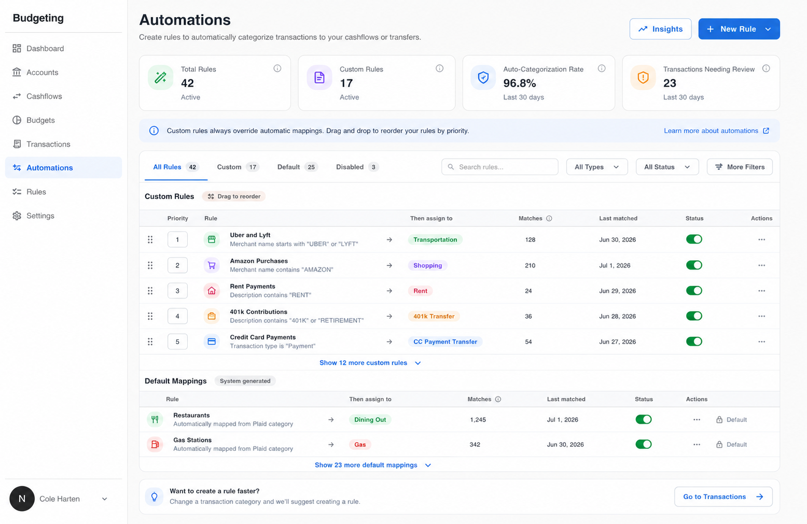

# Budgeting App — Overview

## What this app is

A personal budgeting app that helps answer two related questions:

1. **Planning:** If I project my income and expenses forward, how much money is left over after retirement, savings, and debt payments?
2. **Tracking (future):** How does my *actual* money — pulled from real bank/credit/investment accounts via Plaid — flow into and out of those same accounts, and how does that compare to the plan?

The app is built in two phases. Phase 1 is a pure planning tool with manually entered data. Phase 2 layers in Plaid to ground the plan in real transaction and balance data.

## Tech stack

- Next.js + TypeScript
- MUI for UI components
- Firebase Auth for authentication
- Firestore for data storage

## Core domain model

The data model is split into three concepts that map to three different questions:

| Concept | Question it answers |
|---|---|
| **Cashflows** | *Why* does money move? (income and expense categories) |
| **Accounts** | *Where* does money live, or what debt exists? (assets and liabilities) |
| **Budgets** | *What's the plan* for a given month? (income, expenses, savings allocations, debt payments) |

### Cashflows

Represent categories of recurring or planned income/expense.

```ts
kind: "income" | "expense"
```

Examples: salary, freelance income, rent, groceries, subscriptions.

### Accounts

Represent where money sits or what's owed.

```ts
normalBalance: "asset" | "liability"
```

Examples of assets: checking, savings, brokerage accounts. Examples of liabilities: credit cards, loans, mortgages.

### Budgets

A monthly plan that ties cashflows and accounts together via budget lines.

```ts
lineType: "cashflow" | "account_transfer"
```

- **Cashflow lines** — planned income or expense amounts, tied to a Cashflow category.
- **Account transfer lines** — planned movements of money into/out of an Account: retirement contributions, brokerage contributions, credit card payments, loan payments, etc.

A budget for a given month therefore answers: *given my expected income and expenses this month, how much goes toward savings and debt, and what's left over?*

### Firestore structure

```txt
users/{uid}
users/{uid}/settings/app
users/{uid}/cashflows/{cashflowId}
users/{uid}/accounts/{accountId}
users/{uid}/budgets/{monthKey}
```

## Phase 1 — Planning (current)

Phase 1 is entirely forward-looking and manually entered. There's no connection to real bank data — the user defines their own cashflows and accounts, and builds a budget by hand for each month.

**Pages:**

- **`/cashflows`** — CRUD for income/expense categories. Supports archiving (soft delete) rather than hard deletion, so historical budget lines that reference a cashflow don't break.
- **`/accounts`** — CRUD for asset/liability accounts, with the same archive pattern. Summarizes total assets, liabilities, and net position.
- **`/budgets`** — The core planning surface. For a selected month, pulls active cashflows and accounts and lets the user build out planned income, expenses, savings allocations, and debt payments. Supports navigating between months and copying a previous month's budget as a starting point.
- **`/dashboard`** — A read-only summary view: projected income, expenses, savings, debt payments, leftover cash flow, a budget breakdown, and top planned expenses.
- **`/settings`** — User-level preferences: currency, default budget month.

**The central question Phase 1 answers:** *based on what I plan to earn and spend, how much money is left over each month after I fund savings and pay down debt?*

# Phase 2 Implementation Plan: Plaid Integration & Transaction Engine

## Sub-Phase 2.1: Preparation (Database & UI Foundation)
Before touching the Plaid API, the application needs the structural capacity to store, display, and manipulate raw transaction data, alongside the rules engine to automate it.

### 1. Database Schema Migrations
You need new tables to support the data Plaid will send and the logic required to process it.

* **`PlaidItem` Table:** Stores the connection.
    * `id`, `userId`, `plaidItemId`, `accessToken` (encrypted), `institutionName`, `cursor` (vital for Plaid's `/transactions/sync` endpoint).
* **`Account` Table Updates:**
    * Add `plaidAccountId` (nullable) to link your existing manual accounts to their live Plaid counterparts.
    * Add `mask` (e.g., "1234") and `subtype` (checking, credit card).
* **`Transaction` Table:**
    * `id` (primary key), `plaidTransactionId` (unique).
    * `accountId` (foreign key).
    * `amount`, `date`, `authorizedDate`.
    * `merchantName`, `name` (raw string from bank).
    * `pending` (boolean).
    * `cashflowId` (nullable foreign key - this is how a transaction maps to your Phase 1 budget categories).
* **`TransactionRule` Table:**
    * `id`, `userId`.
    * `matchType` (enum: 'merchant_contains', 'exact_amount', 'plaid_category').
    * `matchValue` (string/number).
    * `actionType` (enum: 'assign_cashflow', 'apply_withholding', 'ignore').
    * `targetId` (foreign key to `Cashflow` or `WithholdingProfile`).

### 2. UI/UX Foundation (React / MUI)
Build the "empty" interfaces so data has a place to land.

* **Transactions Page (`/transactions`):**
    * A robust data grid. Needs columns for Date, Merchant, Amount, Account, and a dropdown for Category (`Cashflow`).
    * Needs quick-filters: "Uncategorized", "Pending", "High Value", and a date range picker.
    * Support for inline editing of the Category dropdown (updates the DB `cashflowId` without a page reload).
* **Rules Engine Page (`/rules`):**
    * An interface to build "If/Then" logic.
    * *Example UI flow:* "IF [Merchant Name] contains [‘Uber’] THEN assign to [Expense: Transportation]."
    * *Example UI flow:* "IF [Deposit] from [‘Gusto’] THEN apply [Withholding Profile: Tech Job]."

---

## Sub-Phase 2.2: Embedding Plaid (The Integration)
This is where you implement the Plaid Node SDK and connect the frontend to the backend.

### 1. The React Frontend (`react-plaid-link`)
* Create a "Connect Bank" component on the Accounts page.
* Fetch a `link_token` from your backend to initialize the Plaid UI modal.
* Implement the `onSuccess` callback. This fires when the user successfully logs into their bank and returns a `public_token`.

### 2. The Next.js API Routes (Backend)
* **`POST /api/plaid/exchange`:** Takes the `public_token` from the frontend, calls Plaid to exchange it for an `access_token` and `item_id`, and saves them to the `PlaidItem` table.
* **`POST /api/plaid/sync`:** The core engine. Uses Plaid's `/transactions/sync` endpoint alongside the `cursor` saved in your database to pull only new, modified, or deleted transactions.
* **`POST /api/plaid/webhook`:** Crucial for Vercel deployments. Plaid will send a webhook (e.g., `SYNC_UPDATES_AVAILABLE`) to this endpoint when new data is ready. This route should immediately trigger the sync function above to keep your app near real-time.

---

## Sub-Phase 2.3: Clean Up, Automation, & Reconciliation
Once raw data is flowing, you must tame it so it fits into the Phase 1 budgeting mental model.

### 1. The Rules Pipeline
Every time the `/api/plaid/sync` job pulls new transactions, it must pipe them through a service function:
1.  Check if `transaction.plaidTransactionId` already exists (update if pending status changed, else insert).
2.  Run the new transaction through all `TransactionRules` for that user.
3.  If a rule matches, auto-assign the `cashflowId`.
4.  *Special Case:* Run the deduplication logic we discussed (match a negative amount in checking with a positive amount in savings within 48 hours and tag them both as internal transfers).

### 2. Upgrading Phase 1 Components
* **Cashflows Page:** Add an "Actuals" column next to the "Estimated Monthly" column. The Actuals column is a sum of all synced transactions tagged with that `cashflowId` for the current month.
* **Visual Feedback:** If "Actuals" > "Estimated", highlight the row in red or show a progress bar that spills over 100%.
* **Accounts Page:** Replace the manual balance input with the live `balances.current` pulled directly from the Plaid API.

### 3. Error Handling & Edge Cases
* **Institution Disconnects:** Plaid connections expire or break (e.g., user changes their bank password). You must build a UI state prompting the user to re-authenticate (Update Mode) when the API throws an `ITEM_LOGIN_REQUIRED` error.

## Long-term ideas (post-Phase 2)

- **Linked expenses** — expenses that derive from other values rather than being entered directly (e.g., tax owed as a function of income).
- **Tax-aware accounting** — pull in tax bracket data to more accurately project take-home income and tax liabilities.
- **Rules engine** — a system for backfilling real (Plaid) transactions to the *original* planned expense they belong to, net of tax and other adjustments. This is likely the biggest lift and depends heavily on Phase 2 being in place.
- **Richer debt modeling** — interest accrual, compounding, payoff projections, rather than treating debt payments as flat planned transfers.

## Engineering conventions

- Don't use MUI `Stack` — use `Box`, `Grid`, or plain flex containers.
- Prefer explicit pixel values in `sx`/CSS (e.g. `"8px"`, `"16px"`) over MUI spacing shorthand (`p: 2`, `gap: 2`).
- Soft-delete (archive) rather than hard-delete Cashflows and Accounts, since Budgets reference them by ID and shouldn't break if the referenced item is later archived.


# Rules / Automations System — Product Spec

## 1. Core Concept

The system is not a traditional “rules engine exposed to users.”

It is an **automation layer that maps messy financial data (Plaid + merchant signals) into a clean, user-defined financial model (Cashflows + Transfers).**

Users should never think in terms of Plaid categories. Instead, they define:

- **Cashflows** (e.g. Rent, Dining Out, Groceries)
- **Transfers** (e.g. 401k, Savings, Credit Card Payment)

Everything else is inference + automation.

---

## 2. Data Model Output

Every transaction must resolve to exactly one of:

### A. Cashflow Assignment
Example:
- Starbucks → Dining Out
- Costco → Groceries

### B. Account Transfer
Example:
- Paycheck → Income Account / Cash
- 401k contribution → Retirement Transfer
- Credit card payment → Liability transfer

### C. Unclassified (temporary state)
Only exists before rules + ML resolve it.

---

## 3. Rule System Overview

Rules are **global, user-defined automations** that map:

> Merchant / inferred features → Cashflow or Transfer

Rules are:

- Global (apply across all accounts)
- Ordered by priority (manual control)
- Explicit (user-defined rules override ML/default inference)
- Transparent only when user-defined (ML + default logic is opaque)

---

## 4. Two-Layer Intelligence System

### Layer 1 — Machine Learning Default Mapping (Opaque)

The system uses a background ML model to map:

> Plaid merchant metadata → internal Cashflow / Transfer

Characteristics:

- Hidden from user
- Continuously learned from:
  - Plaid merchant categories
  - Merchant names
  - User corrections
- Provides baseline categorization

**Important design intent:**
This layer should make the system feel “smart out of the box” with minimal setup.

---

### Layer 2 — User Rules (Explicit Overrides)

User rules always override ML.

They are:

- Deterministic
- Visible
- Editable
- Priority-based

Example:




# AI BITS
# Transaction → Cashflow Classification Engine (Default System)

## 1. Problem Context

We are building a financial tracking application that categorizes user transactions (sourced from Plaid) into **user-defined cashflows** such as:

- Rent
- Mortgage
- Coffee
- Dining Out
- Groceries
- Entertainment
- Amazon
- Living Expenses

Unlike traditional finance apps, **cashflows are not fixed categories**. Each user defines their own structure.

### Key Constraint

At the system level, we must classify transactions **before any user-defined rules exist**.

This creates a cold-start problem:

> How do we map raw transaction data into an unknown, user-specific taxonomy?

---

## 2. Available Inputs

Each transaction includes:

- Merchant name (e.g. "STARBUCKS #123")
- Plaid category (e.g. FOOD_AND_DRINK)
- Amount
- Timestamp
- Account type (credit card, debit, savings)

---

## 3. Output Goal

The system must assign each transaction to:

> exactly one user-defined cashflow (or transfer type)

If uncertain:
- leave unclassified OR
- assign a fallback “general” bucket

---

## 4. Design Requirements

The default engine must:

- Work without any user input or rules
- Be deterministic (no LLM dependency)
- Produce reasonable results out-of-the-box
- Handle diverse user-defined cashflow structures
- Be easily overridable by user rules later
- Minimize incorrect assignments (optimize precision over recall)

---

# 5. Potential Solutions

## Solution A — Pure Plaid Category Mapping

### Description

Map Plaid categories directly to semantic buckets:


FOOD_AND_DRINK → Food-like spending
TRANSPORTATION → Transport
RENT_AND_UTILITIES → Housing
INCOME → Income


Then map semantic buckets to closest cashflow.

---

### Pros

- Extremely simple to implement
- No heuristics or logic complexity
- Fully deterministic
- Zero maintenance cost

---

### Cons

- Plaid categories are too coarse
- Fails to distinguish sub-buckets (e.g. Coffee vs Dining Out)
- Poor alignment with user-specific structures
- Feels “dumb” to users
- Low personalization quality

---

## Solution B — Merchant Rule Heuristics (Hardcoded Engine)

### Description

Use known merchant patterns:


"uber", "lyft" → Transportation
"starbucks" → Coffee
"amazon" → Shopping
"whole foods" → Groceries


Combine with Plaid categories.

---

### Pros

- Very high accuracy for common merchants
- Fast and lightweight
- No ML or external dependencies
- Easy to extend incrementally

---

### Cons

- Requires continuous manual maintenance
- Long tail of merchants remains unhandled
- Brittle to merchant naming variations
- Does not generalize well globally

---

## Solution C — Hybrid Deterministic Scoring Engine (Recommended)

### Description

Build a scoring system that combines multiple signals:

- Merchant name match score
- Plaid category semantic mapping
- Transaction amount heuristics
- Recurring pattern detection
- Account-type context

Each transaction is assigned to the highest scoring cashflow.

---

### Example


Score(transaction, cashflow):

merchant similarity weight
category alignment weight
amount pattern match
recurrence boost

---

### Pros

- Strong accuracy without ML
- Handles ambiguity gracefully
- Extensible system
- Fully deterministic and explainable
- No external cost or dependencies
- Works well with user-defined cashflows

---

### Cons

- More complex to implement
- Requires careful tuning of weights
- Still limited in handling edge-case semantics
- Can feel “handcrafted” without learning

---

## Solution D — Rule-First + Weak Default Engine (Recommended Architecture)

### Description

Separate system into two layers:

### Layer 1: Default Engine (this system)
- Provides best-effort classification
- Uses hybrid scoring approach (Solution C)

### Layer 2: User Rules (future override layer)
- Explicit mappings
- Always takes priority over default engine

---

### Pros

- Clean separation of concerns
- Enables strong out-of-box experience
- Fully user-overridable
- Scales well with product maturity
- Supports learning loop via user corrections

---

### Cons

- Requires careful conflict resolution design
- Slightly more complex system architecture

---

## 6. Key Open Design Questions

### 1. Granularity of Default Engine Output

Should the engine:

- Output directly to cashflows?
- OR output intermediate “intent categories” first?

Tradeoff:
- Direct mapping → simpler
- Intent layer → more flexible long-term

---

### 2. Handling Ambiguity

When confidence is low:

- Assign best guess?
- Or leave unclassified?
- Or assign “General Spending” bucket?

---

### 3. Weight Calibration

How should we balance:

- Merchant signals (strong but sparse)
- Plaid categories (broad but reliable)
- Amount patterns (useful but noisy)

---

### 4. Evolution Toward Learning

Should the system eventually:

- Learn from user corrections?
- Or remain fully deterministic?

(Separate from current scope, but impacts design choices)

---

## 7. Recommended Approach

The best approach for the current product stage is:

### ✔ Solution D: Rule-First + Hybrid Deterministic Engine

With:

- Merchant heuristics for high-confidence matches
- Plaid categories as baseline signals
- Amount + recurrence heuristics for refinement
- Deterministic scoring (no ML required)
- Full override capability via future user rules

---

## 8. Summary

The problem is not traditional classification—it is **mapping noisy financial signals into arbitrary user-defined taxonomies.**

The best solution is a **hybrid deterministic scoring engine** that:

- Uses Plaid as a weak prior
- Uses merchant patterns for precision
- Uses heuristics for structure
- Defers to user rules when available

This creates a system that is:

- Accurate enough out of the box
- Fully transparent
- Cheap to run
- Easily extensible into smarter systems later