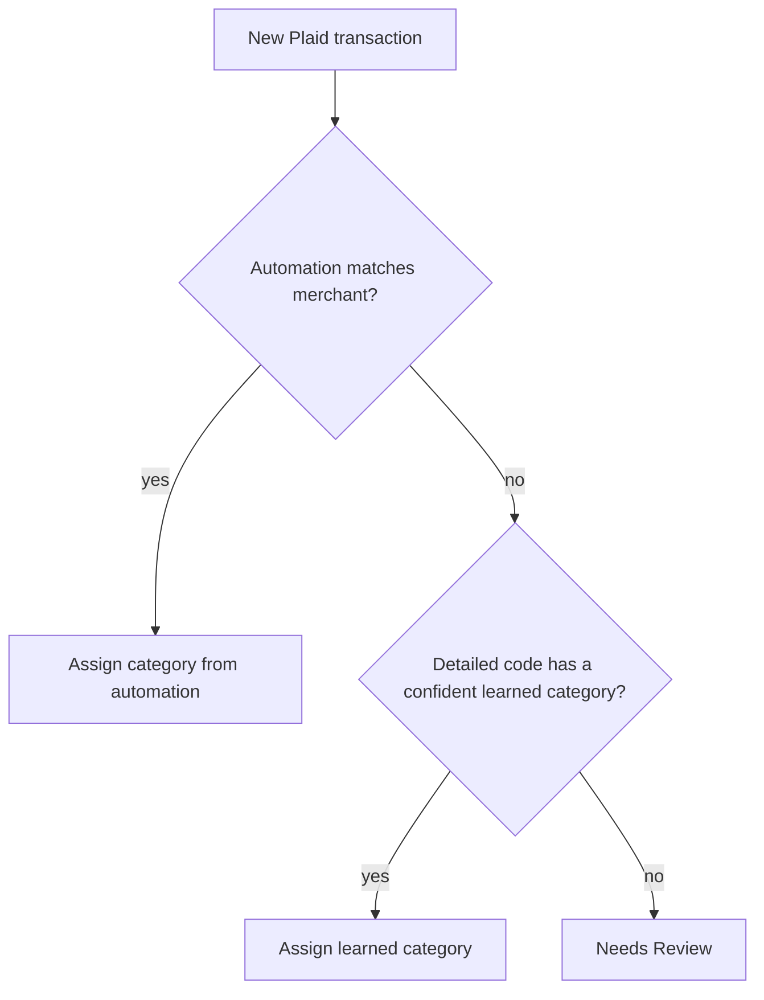

# Design Doc: Learned Plaid-Category Defaults (Tier 2 Categorization)

**Status:** Proposed
**Scope:** Replaces keyword-based Tier 2 matching in the rules engine with a Tier 2 that learns silently from the user's own corrections. No Plaid taxonomy is ever surfaced in the UI.

## 1. Summary

Every Plaid transaction carries a `personal_finance_category.detailed` code (e.g. `FOOD_AND_DRINK_COFFEE`) that Plaid's own classifier assigns. Right now the rules engine ignores it entirely and instead does substring matching against category names/keywords.

The new design: every time the user manually assigns a category to a transaction, we record which category they chose for that transaction's Plaid detailed code. Once enough corrections agree, that code gets a "learned default" — future transactions with the same code auto-assign to that category. The user never sees or picks a Plaid code; it's inferred entirely from behavior they were already going to do (categorizing transactions).

This replaces both the keyword-matching Tier 2 and the earlier "expose a Plaid-category picker on each category" idea. No embeddings, no vector math, no new UI surface — one new Firestore collection and two small functions.

## 2. Non-goals

- Not building an ML/embedding pipeline.ls
- Not exposing Plaid's taxonomy anywhere in the UI.
- Not changing Tier 1 (automations) or Tier 3 (Needs Review) behavior.
- Not building a rules-editor UI.

## 3. How it works



Separately, and independent of which path a transaction took above: **every time the user manually assigns or corrects a category on a transaction**, that (Plaid detailed code → chosen category) pair is recorded as one vote, regardless of whether they also created a Tier 1 automation for that merchant. This is what makes Tier 2 improve over time without any dedicated "teach the system" UI.

## 4. Data model

New per-user Firestore subcollection, one document per Plaid detailed code ever seen:

```
users/{uid}/categoryPlaidStats/{plaidDetailedCode}
  counts: { [categoryId: string]: number }
  updatedAt: Timestamp
```

Example after a few corrections:

```json
// users/abc123/categoryPlaidStats/FOOD_AND_DRINK_COFFEE
{
  "counts": { "cat_diningOut": 4, "cat_businessTravel": 1 },
  "updatedAt": "..."
}
```

**New type** (add to `lib/types/types.ts` — see §9, I don't have this file):

```typescript
// Aggregated learning signal for Tier 2. One doc per Plaid detailed
// category code, scoped to a user. Read once per sync run in
// buildRulesContext, written once per manual correction.
export type CategoryPlaidStats = {
  counts: Record<string, number>; // categoryId -> correction count
  updatedAt?: unknown; // Firestore server timestamp
};
```

**Firestore security rules** — you'll need a rule for this new subcollection mirroring whatever pattern `automations` or `categories` already use (owner-only read/write on `users/{uid}/categoryPlaidStats/{code}`). I don't have your rules file, but this is easy to miss and fails silently as a permission-denied on the client write — flagging so it's not forgotten.

## 5. Confidence resolution

Two thresholds guard against a single miscategorization silently hijacking a code:

- **`MIN_SAMPLES = 3`** — a category needs at least 3 corrections agreeing before Tier 2 will trust it.
- **`MIN_MARGIN = 2`** — the leading category must beat the runner-up by at least 2 corrections, not just be numerically ahead.

Worked examples for a hypothetical `FOOD_AND_DRINK_COFFEE`:

| Corrections so far | Tier 2 assigns? | Why |
|---|---|---|
| Dining Out: 1 | No | Below `MIN_SAMPLES` |
| Dining Out: 3 | **Yes → Dining Out** | Clears both thresholds, no competitor |
| Dining Out: 3, Travel: 2 | No | Margin is only 1 |
| Dining Out: 4, Travel: 2 | **Yes → Dining Out** | Margin is 2 |
| Dining Out: 5, Travel: 4 | No | High volume, but margin still only 1 |

Generic "catch-all" Plaid codes like `GENERAL_MERCHANDISE_OTHER` will naturally spread corrections across many unrelated categories and rarely clear the margin — that's correct behavior, not a bug; those should keep falling to Needs Review.

This resolution is a pure function, so it's trivial to unit test independent of Firestore:

```typescript
function resolveWinner(counts: Record<string, number>): string | null {
  const ranked = Object.entries(counts).sort((a, b) => b[1] - a[1]);
  if (ranked.length === 0) return null;

  const [topId, topCount] = ranked[0];
  const runnerUpCount = ranked[1]?.[1] ?? 0;

  if (topCount < MIN_SAMPLES) return null;
  if (topCount - runnerUpCount < MIN_MARGIN) return null;

  return topId;
}
```

## 6. Recording the signal — `lib/hooks/useTransactions.ts`

`updateTransactionAssignment` is already the single choke-point for every manual category change (whether or not the caller also creates a Tier 1 automation via `useAutomations`), so it's the right place to hook in — no new UI surface needed.

**Import line** — add `setDoc`, `increment`, `serverTimestamp`:

```typescript
import { collection, query, getDocs, orderBy, doc, updateDoc, setDoc, increment, serverTimestamp } from "firebase/firestore";
```

**New helper**, added alongside the other callbacks:

```typescript
const recordCategorySignal = useCallback(
  async (plaidDetailedCode: string, categoryId: string) => {
    if (!user?.uid) return;
    try {
      const statsRef = doc(db, "users", user.uid, "categoryPlaidStats", plaidDetailedCode);
      await setDoc(
        statsRef,
        {
          [`counts.${categoryId}`]: increment(1),
          updatedAt: serverTimestamp(),
        },
        { merge: true }
      );
    } catch (err) {
      // Best-effort learning signal — never block or roll back the user's
      // actual categorization over a failed stats write.
      console.error("[useTransactions] Failed to record category signal:", err);
    }
  },
  [user]
);
```

The dot-path key (`counts.${categoryId}`) with `setDoc(..., { merge: true })` atomically increments just that one nested field and creates the document if it doesn't exist yet — no read-then-write race if two corrections land close together.

**Updated `updateTransactionAssignment`** (replaces the existing function body):

```typescript
const updateTransactionAssignment = useCallback(
  async (transactionId: string, categoryKind: CategoryKind | undefined, categoryId?: string) => {
    if (!user?.uid) return;

    const target = rawTransactions.find((tx) => tx.id === transactionId);
    if (!target) {
      console.error(`[useTransactions] updateTransactionAssignment: no transaction found with id "${transactionId}".`);
      setTransactionsError("Could not find that transaction.");
      return;
    }

    try {
      assertValidAssignment(categoryKind, categoryId, target.originAccId);
    } catch (err) {
      console.error("[useTransactions] Invalid assignment:", err);
      setTransactionsError(err instanceof Error ? err.message : "Invalid assignment.");
      return;
    }

    const previous = rawTransactions;
    setRawTransactions((prev) =>
      prev.map((tx) => (tx.id === transactionId ? { ...tx, categoryKind, categoryId } : tx))
    );

    try {
      const txRef = doc(db, "users", user.uid, "transactions", transactionId);
      await updateDoc(txRef, {
        categoryKind: categoryKind ?? null,
        categoryId: categoryId ?? null,
        updatedAt: Date.now(),
      });
    } catch (err) {
      console.error("Failed to update assignment:", err);
      setTransactionsError("Failed to update assignment.");
      setRawTransactions(previous); // revert optimistic update
      return;
    }

    // Record a Tier 2 learning signal — only for genuine corrections: a
    // real category (not a clear), a transaction that actually has a Plaid
    // detailed code to learn from, and an assignment that's different from
    // what it was before (so re-saving the same category twice doesn't
    // inflate its count).
    const isRealAssignment = Boolean(categoryKind) && Boolean(categoryId);
    const isActuallyDifferent =
      target.categoryKind !== categoryKind || target.categoryId !== categoryId;

    if (isRealAssignment && isActuallyDifferent && target.plaidCategoryDetailed) {
      recordCategorySignal(target.plaidCategoryDetailed, categoryId!);
    }
  },
  [user, rawTransactions, recordCategorySignal]
);
```

Note this is fire-and-forget (not awaited) — the stats write is a background signal, not something the UI should wait on or roll back the user's actual categorization over.

## 7. Resolving matches — `lib/ruleEngine.ts` (full rewrite)

> ⚠️ **Verify before shipping:** the version of this file you shared still names its fields `assignmentType`/`assignmentId`, while your Firestore schema, `useTransactions.ts`, and the Dashboard all use `categoryKind`/`categoryId`. This rewrite renames them to match. If `plaidSyncService.ts` currently constructs the object it passes into `applyRules` (or writes the result to Firestore) using the old names, it needs a matching update — otherwise synced transactions may currently be writing to fields nothing else reads. Worth confirming directly; see §9.

```typescript
import { adminDb } from "@/lib/firebaseAdmin";
import { normalizeMerchant } from "@/lib/merchant";
import type { Automation, Category, CategoryKind } from "@/lib/types/types";
import type { Transaction as PlaidTransaction } from "plaid";

/**
 * Everything applyRules needs to score transactions for one user.
 * Fetched once per sync run, not once per transaction.
 */
export type RulesContext = {
  categories: Category[];
  automations: Map<string, string>; // merchantKey -> categoryId
  plaidCategoryDefaults: Map<string, string>; // plaidDetailedCode -> categoryId
};

// ---------------------------------------------------------------------------
// Confidence resolution for learned Plaid-category -> Category mappings
// ---------------------------------------------------------------------------

/**
 * A code needs at least this many corrections pointing at the same category
 * before Tier 2 will auto-assign on it. Below this, a single miscategorized
 * transaction could otherwise hijack the whole code.
 */
const MIN_SAMPLES = 3;

/**
 * The winning category must lead the runner-up by at least this many
 * corrections. Guards against a near-even split (e.g. 4 vs 3) being treated
 * as a confident signal.
 */
const MIN_MARGIN = 2;

/**
 * Picks a winning categoryId from a { categoryId: count } map, or null if
 * the signal isn't strong enough yet. Pure function — no I/O — so it's easy
 * to unit test independent of Firestore.
 */
function resolveWinner(counts: Record<string, number>): string | null {
  const ranked = Object.entries(counts).sort((a, b) => b[1] - a[1]);
  if (ranked.length === 0) return null;

  const [topId, topCount] = ranked[0];
  const runnerUpCount = ranked[1]?.[1] ?? 0;

  if (topCount < MIN_SAMPLES) return null;
  if (topCount - runnerUpCount < MIN_MARGIN) return null;

  return topId;
}

// ---------------------------------------------------------------------------
// Context building
// ---------------------------------------------------------------------------

export async function buildRulesContext(uid: string): Promise<RulesContext> {
  const [categoriesSnap, automationsSnap, statsSnap] = await Promise.all([
    adminDb.collection("users").doc(uid).collection("categories").get(),
    adminDb.collection("users").doc(uid).collection("automations").get(),
    adminDb.collection("users").doc(uid).collection("categoryPlaidStats").get(),
  ]);

  const categories = categoriesSnap.docs.map(
    (d) => ({ id: d.id, ...(d.data() as Omit<Category, "id">) })
  );

  const automations = new Map<string, string>();
  automationsSnap.docs.forEach((d) => {
    const data = d.data() as Automation;
    automations.set(data.merchantKey, data.categoryId);
  });

  const plaidCategoryDefaults = new Map<string, string>();
  statsSnap.docs.forEach((d) => {
    const data = d.data() as { counts?: Record<string, number> };
    const winner = resolveWinner(data.counts ?? {});
    if (winner) plaidCategoryDefaults.set(d.id, winner);
  });

  return { categories, automations, plaidCategoryDefaults };
}

// ---------------------------------------------------------------------------
// applyRules
// ---------------------------------------------------------------------------

/**
 * Assigns a transaction to a category using, in order:
 *   1. A manual automation (merchant -> category override) — always wins.
 *   2. A learned Plaid-category default: if enough past corrections agree
 *      that transactions with this Plaid `detailed` code belong to the same
 *      category, assign it there. Replaces keyword/name substring matching
 *      entirely — see the design doc for rationale.
 *   3. Otherwise leaves the transaction unassigned ("Needs Review") — both
 *      fields set to null, not a sentinel string.
 *
 * categoryKind mirrors the matched category's `kind` directly (income,
 * expense, or transfer).
 */
export async function applyRules<T extends {
  merchantName: string | null;
  rawName: string;
  category: PlaidTransaction["personal_finance_category"] | null;
  categoryKind: CategoryKind | null;
  categoryId: string | null;
}>(transaction: T, context: RulesContext): Promise<T> {
  const merchantKey = normalizeMerchant(transaction.merchantName ?? transaction.rawName);

  // 1. Manual automation always wins.
  const automatedCategoryId = context.automations.get(merchantKey);
  if (automatedCategoryId) {
    const automatedCategory = context.categories.find((c) => c.id === automatedCategoryId);
    if (automatedCategory) {
      return { ...transaction, categoryKind: automatedCategory.kind, categoryId: automatedCategory.id };
    }
    // Automation points at a category that no longer exists — fall through.
  }

  // 2. Learned Plaid-category default.
  const detailedCode = transaction.category?.detailed;
  if (detailedCode) {
    const learnedCategoryId = context.plaidCategoryDefaults.get(detailedCode);
    if (learnedCategoryId) {
      const learnedCategory = context.categories.find((c) => c.id === learnedCategoryId);
      if (learnedCategory) {
        return { ...transaction, categoryKind: learnedCategory.kind, categoryId: learnedCategory.id };
      }
      // Learned category was deleted since the stats accrued — fall through.
    }
  }

  // 3. No match — leave for the user to review.
  return { ...transaction, categoryKind: null, categoryId: null };
}
```

Note that `buildRulesContext`'s call signature (`uid: string`) and `applyRules`'s call signature are unchanged — `RulesContext` just grew one field. If `plaidSyncService.ts` simply calls `buildRulesContext` once per sync run and `applyRules` per transaction (as the original comments imply), it needs **zero structural changes**, only the field-name fix noted above.

## 8. Removing keywords — `lib/hooks/useCategories.ts`

Three spots, all removing `keywords` outright per "removing keywords entirely":

**Payload type:**

```typescript
type AddCategoryPayload = {
  name: string;
  kind: CategoryKind;
  estimatedMonthly: number;
  description?: string;
  transferAccountId?: string | null;
  paycheckDetails?: PaycheckDetails | null;
};
```

**`addCategory` write** — delete this line:

```typescript
keywords: payload.keywords ?? [],
```

**`onSnapshot` read mapping** — delete this line:

```typescript
keywords: data.keywords ?? [],
```

One related but separate observation: `plaidCategories: data.plaidCategories ?? []` also exists on `Category` already, unused by this new design (it predates this conversation, so I don't know if something else reads it). Unlike `keywords`, I'm not confidently recommending removing it — flagging it as possibly redundant now, worth a quick check on your end for other references before deleting.

## 9. Files I don't have — need these to finish the job

I only have what's been pasted into this conversation. These need corresponding changes but I can't write exact patches blind:

| File | What needs to change |
|---|---|
| `lib/types/types.ts` | Add `CategoryPlaidStats` (§4). Remove `keywords` from `Category`. |
| `lib/plaidSyncService.ts` (or wherever sync writes happen) | Confirm it still calls `buildRulesContext` once per sync run, not per transaction. Confirm/fix the `assignmentType`/`categoryKind` naming per the §7 warning. |
| `AddCategoryModal.tsx`, `CategoriesPage.tsx` | Remove whatever keyword input field(s) currently write to `payload.keywords`. |

Happy to produce exact patches for these — paste them in and I'll do it directly.

## 10. Edge cases handled by this design

- **Dangling category references** (automation or learned mapping points at a deleted category) — falls through to the next tier, same defensive pattern as the existing Tier 1 code.
- **No Plaid detailed code** (manual transaction, or Plaid didn't provide one) — Tier 2 is skipped, and no correction on it is ever recorded (nothing to learn a code-mapping from).
- **Unassigning a transaction** — clearing `categoryKind`/`categoryId` never records a signal; only positive assignments do.
- **Re-saving the same category** — guarded by the `isActuallyDifferent` check, so clicking save twice doesn't inflate a code's count.
- **Catch-all Plaid codes** (`GENERAL_MERCHANDISE_OTHER`, etc.) — naturally spread across categories, rarely clear the margin, correctly stay in Needs Review.

## 11. Deliberately open questions

These are genuine judgment calls, not blocking issues — the design above ships fine with the defaults stated, but worth confirming:

1. **Archived categories** — right now, both Tier 1 and this new Tier 2 will happily assign to an archived category if it's still referenced by an automation or a learned mapping (existing Tier 1 behavior, preserved here for consistency). Worth excluding?
2. **Overwrite semantics** — when a user corrects a transaction *away* from what Tier 2 previously assigned, the old category's count isn't decremented, just diluted by future corrections. Simpler and fully auditable, but slower to self-correct than a decrement would be.
3. **Scope of the keyword removal** — full purge from schema/type/UI (as written above), or just stop using it for matching and leave the field in place?

## 12. Rollout order

1. Add the Firestore security rule for `categoryPlaidStats`.
2. Add `CategoryPlaidStats` type; remove `keywords` from `Category` (types.ts).
3. Replace `ruleEngine.ts` (§7).
4. Update `useTransactions.ts` (§6).
5. Strip `keywords` from `useCategories.ts` and its UI callers (§8, §9).
6. Confirm `plaidSyncService.ts` needs no structural change, fix field naming if needed (§7 warning).
7. Optional: if there's existing transaction history with corrections already made, a one-off script replaying past corrections through the same increment logic would give Tier 2 a head start instead of learning from zero.